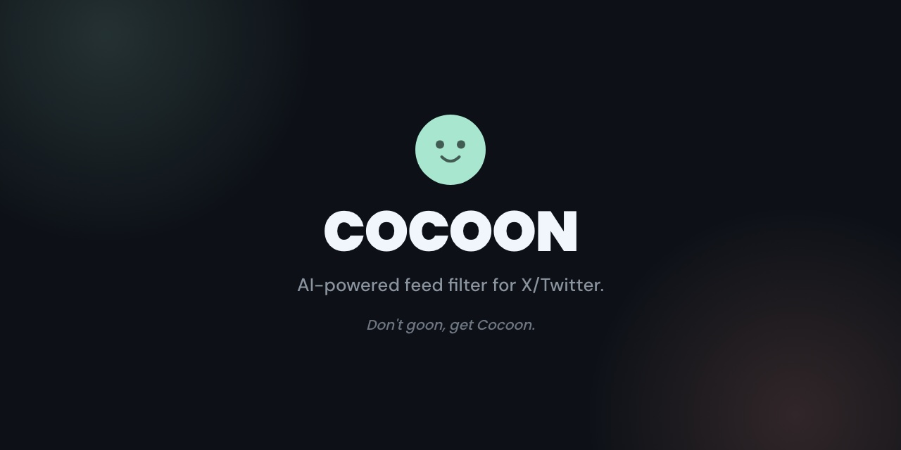

<p align="center">
  
</p>

<p align="center">
  <a href="https://chromewebstore.google.com/detail/cocoon/ohidacajglhknbikhmdbkaiplbgcgjkj">Chrome Web Store</a> ·
  <a href="#installation">Installation</a> ·
  <a href="#how-it-works">How It Works</a>
</p>

---

## What is Cocoon?

Cocoon is a browser extension that filters your X/Twitter feed using AI. You tell it what you care about, and it hides everything else.

No more rage bait. No more engagement farming. No more algorithmic garbage you never asked for.

**Features:**

- Define your interests in plain English
- Block content categories (political outrage, clickbait, celebrity gossip, etc.)
- Keyword blocking for instant filtering
- Works on home feed, search, profiles, and individual posts
- Quota system to limit daily scrolling (optional)
- Multiple themes

## How It Works

1. You provide an [OpenRouter](https://openrouter.ai/keys) API key (free tier available)
2. You configure your interests and blocks
3. As you scroll, Cocoon sends batches of posts to Grok for classification
4. Posts that don't match your interests get hidden

Your API key is encrypted and stored locally. Post content is sent to the LLM for classification but nothing is stored or logged on any server.

## Installation

### Chrome Web Store (Recommended)

Install from the [Chrome Web Store](https://chromewebstore.google.com/detail/cocoon/ohidacajglhknbikhmdbkaiplbgcgjkj).

### From Source

```bash
# Clone the repo
git clone https://github.com/cocoon-extension/cocoon.git
cd cocoon

# Install dependencies
npm install

# Build the extension
npm run build

# Load in Chrome:
# 1. Go to chrome://extensions
# 2. Enable "Developer mode"
# 3. Click "Load unpacked"
# 4. Select the .output/chrome-mv3 directory
```

### Firefox (Untested)

Firefox builds but has not been tested. If you try it, let us know how it goes.

```bash
npm run build:firefox
# Load .output/firefox-mv2 in about:debugging
```

## Development

```bash
# Start dev server with hot reload
npm run dev

# Firefox
npm run dev:firefox

# Type checking
npm run check
```

## Tech Stack

- [Svelte 5](https://svelte.dev/) - UI framework
- [WXT](https://wxt.dev/) - Browser extension framework
- [Tailwind CSS](https://tailwindcss.com/) - Styling
- [TypeScript](https://www.typescriptlang.org/) - Type safety
- [OpenRouter](https://openrouter.ai/) - LLM API gateway (Grok by default)

## Configuration

After installation, click the Cocoon icon and complete the setup:

1. **API Key** - Get a free key from [OpenRouter](https://openrouter.ai/keys)
2. **Interests** - Topics you want to see (AI, design, startups, etc.)
3. **Blocks** - Content to always hide (rage bait, ads, political outrage, etc.)

Advanced settings available in the options page.

## License

[GPL-2.0](LICENSE)

This is copyleft software. If you modify and distribute it, you must also release your modifications under GPL-2.0.

## Roadmap

- [ ] Firefox support (builds, but untested)
- [ ] Reddit
- [ ] YouTube
- [ ] Threads (maybe)

## Contributing

PRs welcome. Fork it, build something, open a PR.

---

<p align="center">
  Built by Davey
  <br><br>
  <a href="https://x.com/daveylovescode">X</a> ·
  <a href="https://discord.com/invite/jAY6wWr">Discord</a> ·
  <a href="https://www.youtube.com/@DaveyDesign">YouTube</a>
</p>
